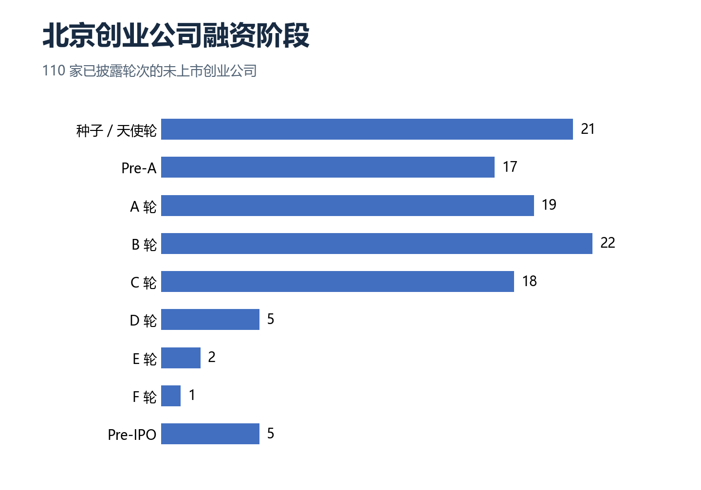

# 北京 AI 公司地图

在地图上找北京的 AI 公司，查看公司位置、业务方向和招聘入口。

**[打开地图](https://ningsiyuan1024.github.io/ai-company-map/)** · [欢迎补充](https://github.com/ningsiyuan1024/ai-company-map/issues)

[](https://ningsiyuan1024.github.io/ai-company-map/)

收录 **307 家北京公司与团队**，另支持上海、深圳、杭州和广州。目前主要维护北京，数据更新于 2026 年 11 月 14 日。

## 技术方向与招聘入口

307 家公司与团队中，188 家附有招聘入口。同一团队可覆盖多个方向。


## 创业公司专题



[查看区域分布与完整图集](docs/CHARTS.md)

## 使用

搜索公司或方向，按区域、融资阶段、投资机构筛选；点击公司查看详情和招聘入口。复制浏览器地址即可分享当前结果。

## 简历匹配

把 [Skill 下载包](skills/ai-company-match.zip)和简历或工作经历交给自己的 Agent，获取推荐公司、匹配理由和投递清单。支持读取 Skill 文件的 Agent 也可直接使用 [SKILL.md](skills/ai-company-match/SKILL.md)。

## 信息源

| 信息源 | 信息内容 |
| --- | --- |
| [胡润研究院](https://www.hurun.net/) | AI 企业榜单、独角兽身份 |
| [香港交易所披露易](https://www.hkexnews.hk/) | 上市公告、公司定期披露 |
| [巨潮资讯](https://www.cninfo.com.cn/) | 上市公告书、财务报告 |
| [Nasdaq Trader](https://www.nasdaqtrader.com/) | 美国上市主体与证券代码 |
| [泛欧交易所 Euronext](https://www.euronext.com/) | 欧洲上市主体与证券信息 |
| [清科投资界](https://www.pedaily.cn/) | 融资轮次、投资方、披露日期 |
| [国金证券](https://www.gjzq.com.cn/) | 企业融资阶段研究资料 |
| [启明创投](https://www.qimingvc.com/) | 被投企业融资与发展动态 |
| [普华永道](https://www.pwccn.com/) | 行业投融资报告 |
| [投中网](https://www.chinaventure.com.cn/) | 创业公司融资报道 |
| [36氪](https://www.36kr.com/) | 创业公司融资与业务报道 |
| [OFweek](https://www.ofweek.com/) | 机器人产业年度报告 |
| [企业官方公告（如 PixVerse）](https://pixverse.ai/) | 企业直接披露的融资与上市信息 |

<details>
<summary>本地运行</summary>

需要 Python 3。在终端运行以下命令后，打开 <http://127.0.0.1:8766/>。

```bash
git clone https://github.com/ningsiyuan1024/ai-company-map.git
cd ai-company-map
python -m http.server 8766 --bind 127.0.0.1
```

</details>

## 许可

代码采用 [MIT License](LICENSE)，北京底图采用 [ODbL 1.0](MAP-DATA-LICENSE.md)。[Leaflet](vendor/leaflet/LICENSE) 和[坐标转换库](COORDTRANSFORM-LICENSE) 保留各自许可。公司、招聘及融资资料归原权利人所有，再分发时请保留来源并遵守原使用条件。
