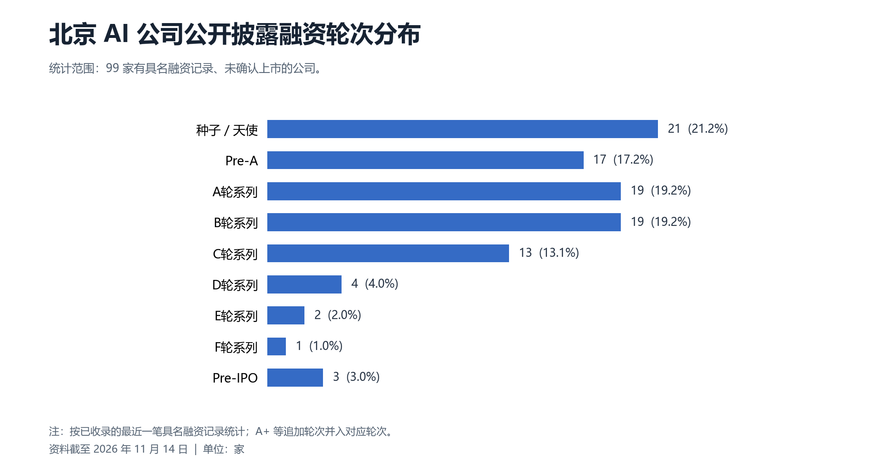

# 北京 AI 公司地图

在地图上找北京的 AI 公司，查看公司位置、业务方向和招聘入口。

**[打开地图](https://ningsiyuan1024.github.io/ai-company-map/)** · [补充公司 / 纠错](https://github.com/ningsiyuan1024/ai-company-map/issues)

[](https://ningsiyuan1024.github.io/ai-company-map/)

目前收录 **307 家北京公司与团队**，涵盖大模型、Agent、机器人、自动驾驶、AI 芯片等方向。另可切换上海、深圳、杭州和广州。数据更新于 2026 年 11 月 14 日，目前主要维护北京。

## 公司阶段




## 方向分布


## 使用

1. 搜索公司名或感兴趣的方向，也可以按区域、融资阶段、投资机构筛选。
2. 点击公司，查看地址、公司介绍和信息来源。
3. 点击招聘入口，前往招聘页面了解岗位。

复制浏览器地址，即可分享当前筛选结果或选中的公司。

## 信息源

| 信息源 | 信息内容 |
| --- | --- |
| [胡润研究院](https://www.hurun.net/) | AI 企业榜单、独角兽身份 |
| [香港交易所披露易](https://www.hkexnews.hk/) | 上市公告、公司定期披露 |
| [巨潮资讯](https://www.cninfo.com.cn/) | 上市公告书、财务报告 |
| [Nasdaq Trader](https://www.nasdaqtrader.com/) | 美国上市主体与证券代码 |
| [泛欧交易所 Euronext](https://www.euronext.com/) | 欧洲上市主体与证券信息 |
| [清科投资界](https://www.pedaily.cn/) | 融资轮次、投资方、披露日期 |
| [国金证券](https://www.gjzq.com.cn/) | 企业融资阶段研究资料 |
| [企业官方公告（如 PixVerse）](https://pixverse.ai/) | 企业直接披露的融资与上市信息 |

## 补充与纠错

发现遗漏公司、失效链接或错误地址，欢迎[提交反馈](https://github.com/ningsiyuan1024/ai-company-map/issues)。请附公司名称、需要修改的内容和来源链接。补充北京公司时，请提供能确认北京团队或岗位的页面。

<details>
<summary>本地运行与部署</summary>

需要 Python 3。在终端运行以下命令后，打开 <http://127.0.0.1:8766/>。

```bash
git clone https://github.com/ningsiyuan1024/ai-company-map.git
cd ai-company-map
python -m http.server 8766 --bind 127.0.0.1
```

网站使用 HTML、CSS 和 JavaScript，无需安装前端依赖或配置 API 密钥，也可直接部署到静态网站托管平台。

北京底图随网站加载，其他城市使用 OpenStreetMap 在线地图。底图来源、坐标处理与许可见[地图数据说明](MAP-DATA-LICENSE.md)。

</details>

## 许可

本项目自有代码采用 [MIT License](LICENSE)。北京底图遵循 ODbL 1.0，见[地图数据说明](MAP-DATA-LICENSE.md)。第三方组件保留各自许可，包括 [Leaflet](vendor/leaflet/LICENSE) 和[坐标转换库](COORDTRANSFORM-LICENSE)。公司、招聘和融资来源内容的权利归原权利人，使用或再分发时请保留来源并核对其使用条件。
