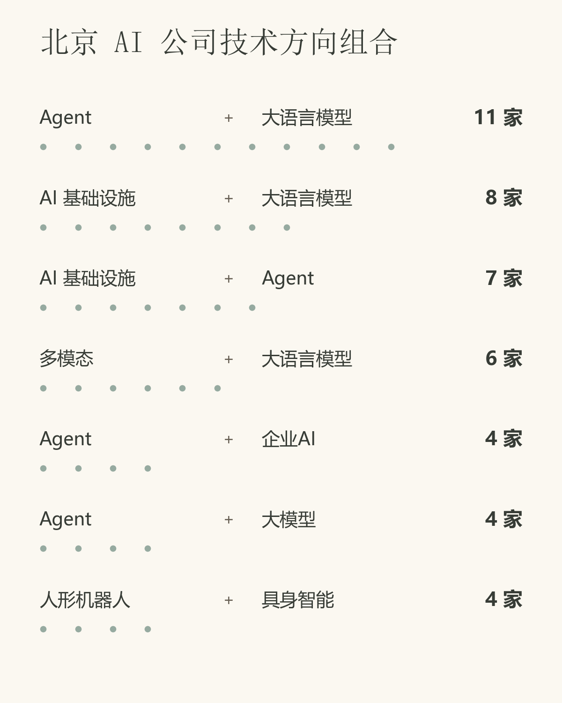

# 北京 AI 公司求职图集

[下载全部图表](images/beijing-company-charts.zip) · [打开地图](https://ningsiyuan1024.github.io/ai-company-map/)

## 公司与团队

北京 · 307 家公司与团队

[查看完整名单](EMPLOYERS.md)

213 家公司与团队有具体区域，跨区分别计数，共 223 次。房山、平谷、密云、延庆暂无区域记录。

[算法岗位](JOBS.md#算法) · [工程岗位](JOBS.md#工程) · [产品岗位](JOBS.md#产品) · [运营岗位](JOBS.md#运营)

## 创业公司专题

这 110 家创业公司都还没上市，也都公布过融资轮次。

