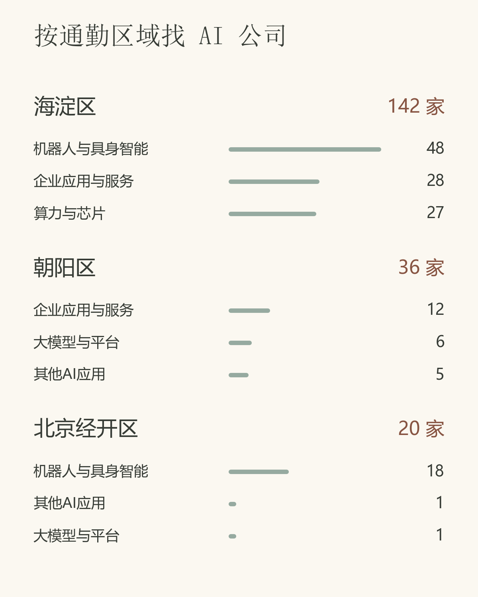

# 北京 AI 公司求职图集

[下载全部图表](images/beijing-company-charts.zip) · [打开地图](https://ningsiyuan1024.github.io/ai-company-map/)

## 公司与团队

北京 · 307 家公司与团队

[查看完整名单](EMPLOYERS.md)

213 家公司与团队有具体区域，跨区分别计数，共 223 次。房山、平谷、密云、延庆暂无区域记录。

查看地图上的公司：[海淀区](https://ningsiyuan1024.github.io/ai-company-map/?region=海淀区) · [朝阳区](https://ningsiyuan1024.github.io/ai-company-map/?region=朝阳区) · [北京经开区](https://ningsiyuan1024.github.io/ai-company-map/?region=北京经济技术开发区)

## 创业公司专题

这 110 家创业公司都还没上市，也都公布过融资轮次。

