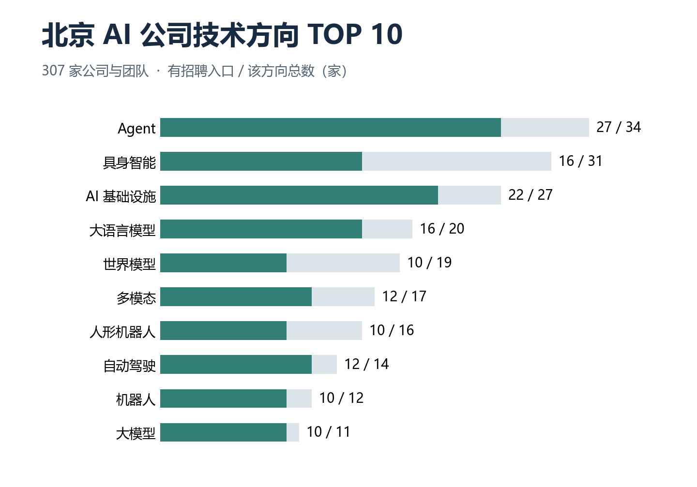
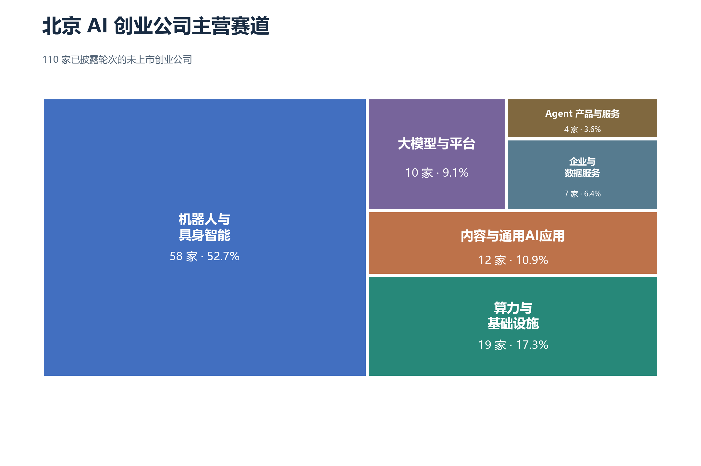
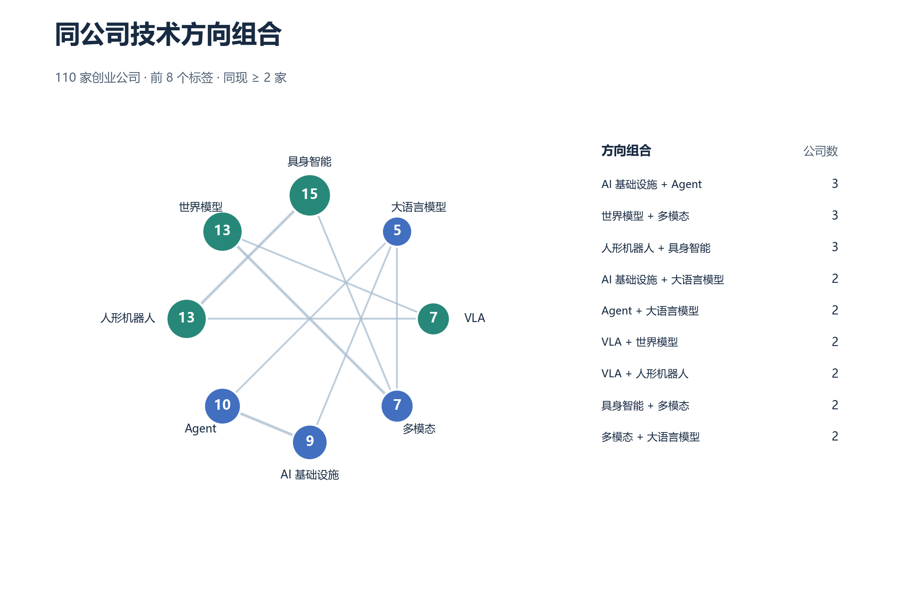
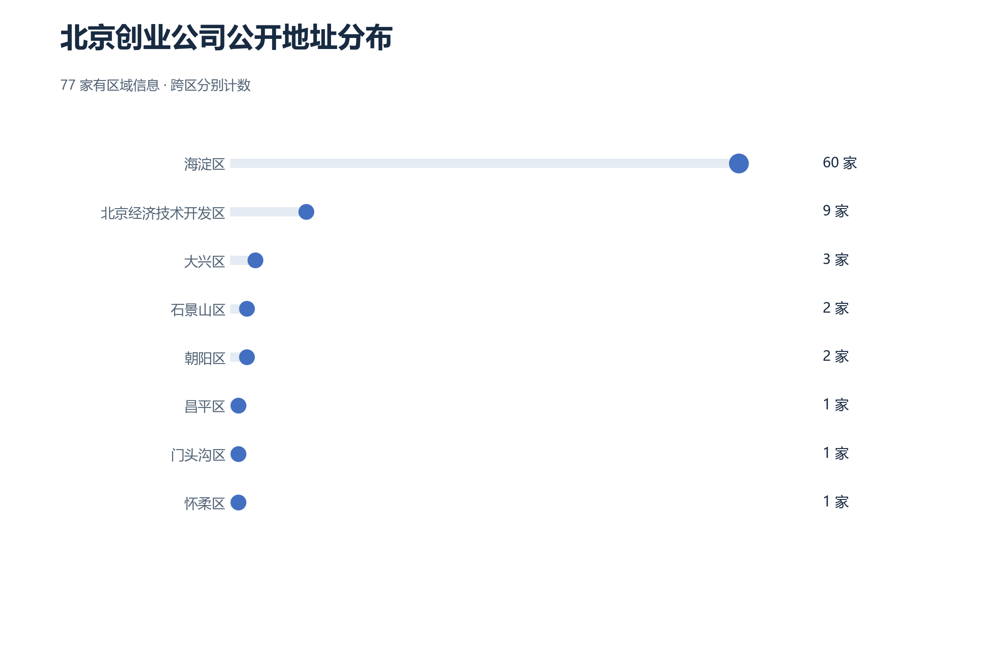
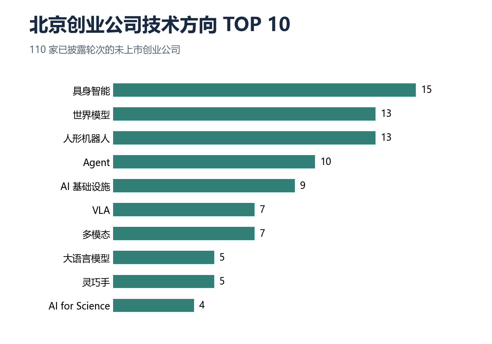

# 北京 AI 公司求职图集

[下载全部图表](images/beijing-company-charts.zip) · [打开地图](https://ningsiyuan1024.github.io/ai-company-map/)

## 公司与团队

北京目录收录 307 家公司与团队，188 家附有招聘入口。一个团队可有多个技术方向。具体岗位和工作地点以招聘页为准。

## 创业公司专题

110 家已披露融资轮次的未上市创业公司，同一公司旗下产品合并计数。融资阶段按已披露的具名轮次归类。

### 主营赛道

### 赛道与融资阶段

### 技术方向组合

### 北京区域分布

### 投资机构覆盖

### 招聘入口收录

### 融资阶段

### 技术方向

