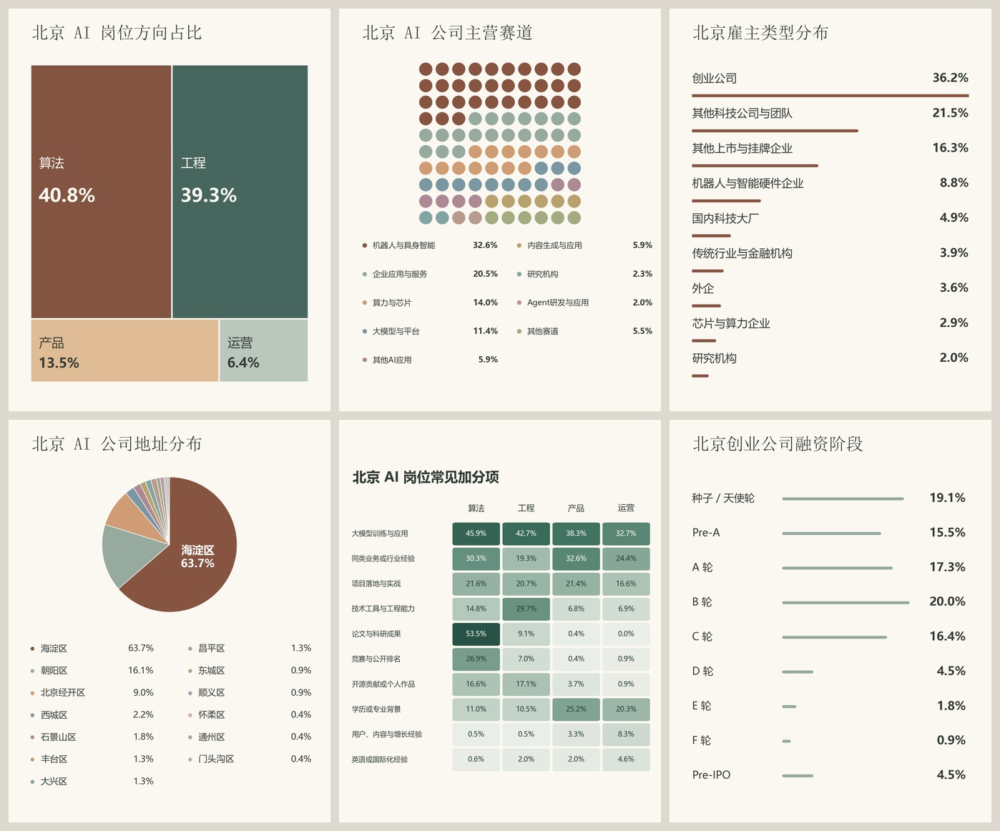

# 北京 AI 公司求职图集

[下载原图与单图](images/beijing-company-charts.zip) · [完整雇主名单](EMPLOYERS.md) · [打开地图](https://ningsiyuan1024.github.io/ai-company-map/)

[算法岗位](JOBS.md#算法) · [工程岗位](JOBS.md#工程) · [产品岗位](JOBS.md#产品) · [运营岗位](JOBS.md#运营)

[放大查看岗位加分项](images/beijing-job-preferences.png)

统计口径

岗位方向按收录的北京职位记录计算。主营赛道和雇主类型按北京目录条目计算。地址按雇主在各区出现的记录计算，同一雇主在同一区只记一次。融资阶段仅统计披露具名轮次的未上市创业公司。加分项按各方向明确写出招聘偏好的岗位计算，同一岗位可涉及多个主题。

