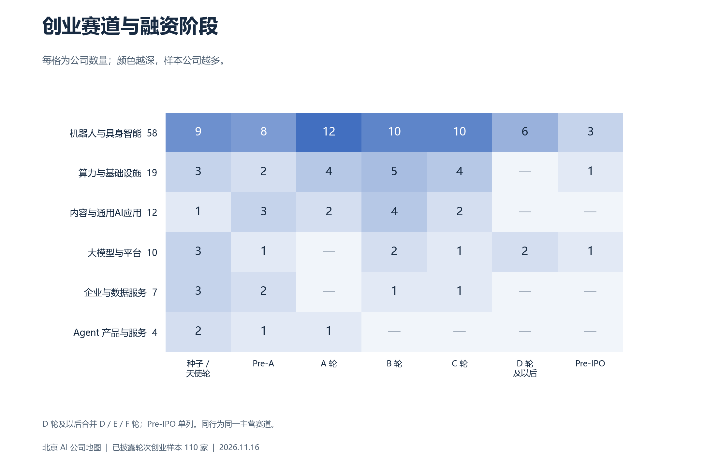
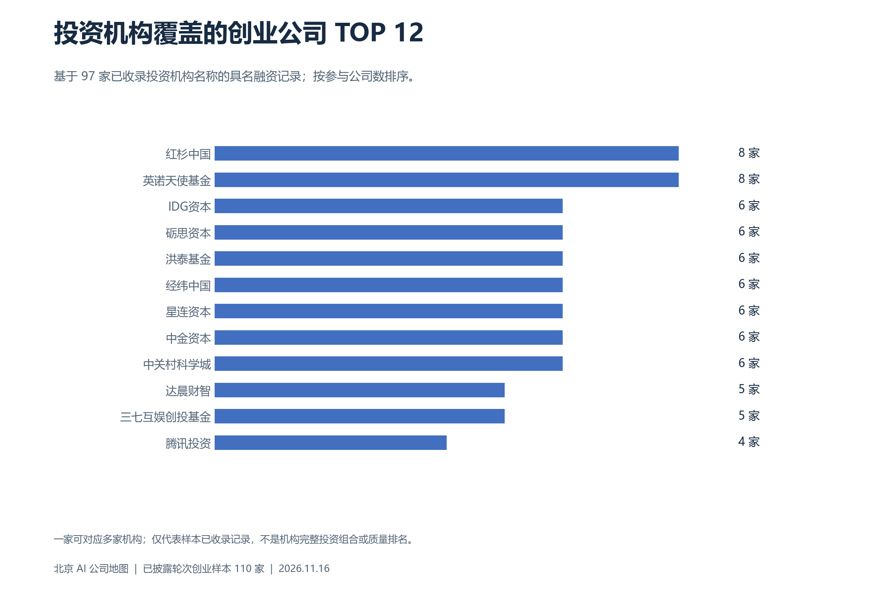
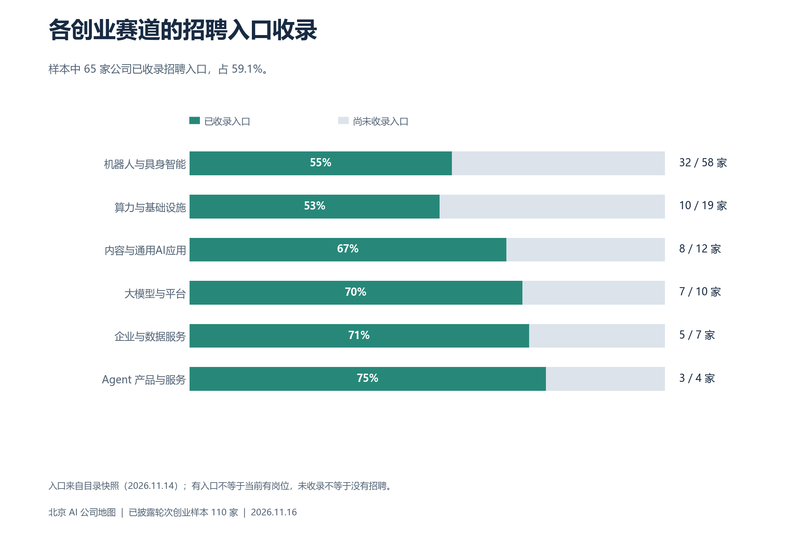

# 北京 AI 创业公司图表集

统计范围为北京目录中 **110 家已披露融资轮次的未上市创业公司**，同一公司旗下产品合并计数。统计日期为 2026 年 11 月 16 日。

[下载全部图表（9 张 PNG）](images/beijing-startup-charts.zip) · [打开地图](https://ningsiyuan1024.github.io/ai-company-map/)

## 主营赛道

## 赛道与融资阶段

## 技术方向组合

## 北京区域分布

## 投资机构覆盖

## 招聘入口收录

## 融资阶段

## 技术方向

