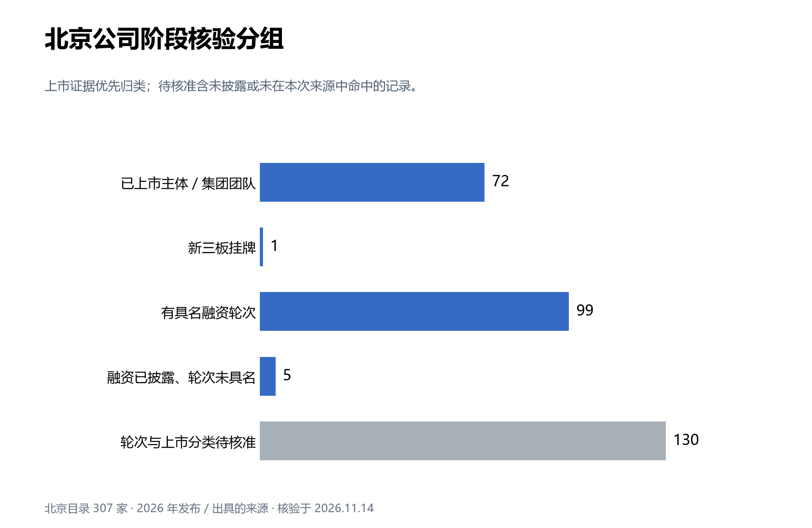
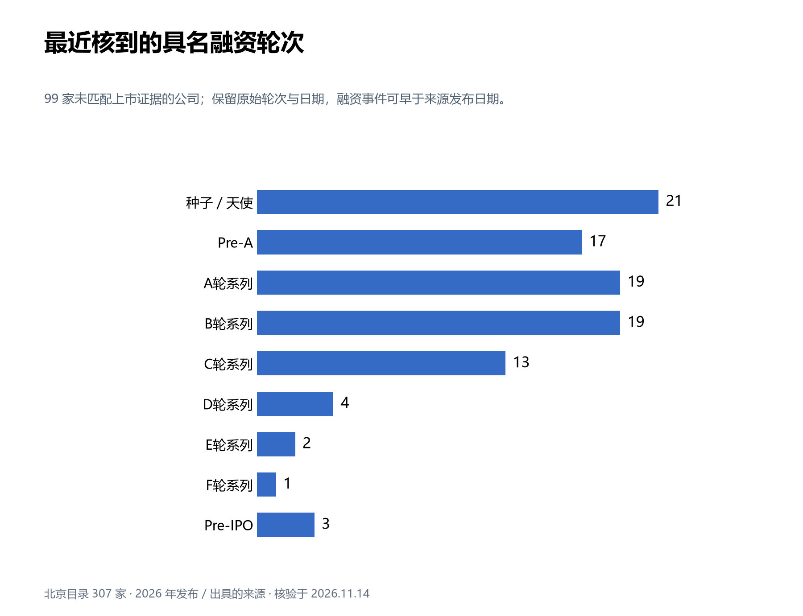
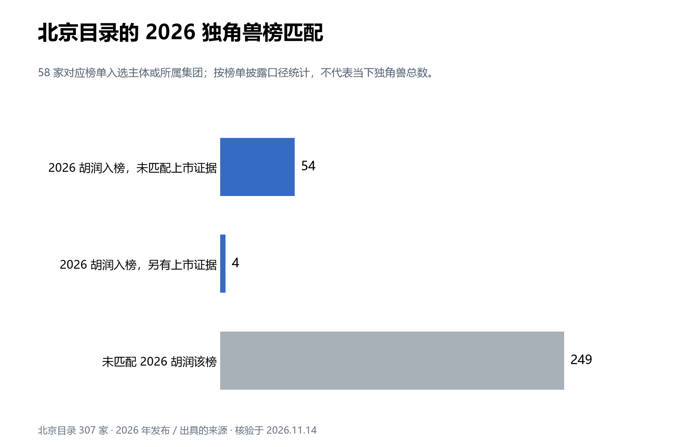

# 北京公司融资与上市核验 2026

核验日期为 2026 年 11 月 14 日，范围为北京目录的 307 个公司 ID。所有用于本次融资、上市和独角兽结论的来源均在 2026 年发布、出具或生成。历史交易发生时间与来源发布日期分别保留。

307 条记录均有核验状态和字段。200 家在本次来源范围内至少匹配到一类有效证据，107 家尚未匹配到这三类可确认信息。阶段分组中有 130 家待核准，其中也包括仅确认到独角兽榜身份、尚未确认融资轮次或上市身份的公司。

## 阶段核验分组

| 分组 | 公司数 |
| --- | ---: |
| 公司主体或所属集团有上市证据 | 72 |
| 新三板挂牌 | 1 |
| 有具名融资轮次，未匹配上市证据 | 99 |
| 有融资披露，轮次未具名 | 5 |
| 融资轮次与上市分组待核准 | 130 |
| 合计 | 307 |

图中上市主体优先归类，再按最近核到的融资轮次分组。集团产品团队对应的上市身份标明为“所属集团”。未匹配到上市证据的记录，上市状态保持待核准。

## 具名融资轮次

| 本次最近核到的轮次 | 公司数 |
| --- | ---: |
| 种子／天使系列 | 21 |
| Pre-A 系列 | 17 |
| A 轮系列 | 19 |
| B 轮系列 | 19 |
| C 轮系列 | 13 |
| D 轮系列 | 4 |
| E 轮系列 | 2 |
| F 轮系列 | 1 |
| Pre-IPO | 3 |
| 合计 | 99 |

A+、A++ 等并入 A 轮系列，其余字母同理；Pre-A 和 Pre-IPO 分列。股权转让、出资设立、定向增发和基石投资从私人融资轮次统计中排除。战略融资与未注明字母轮次的股权融资归入“轮次未具名”。

共 108 家有融资证据，其中 4 家另有上市证据，因此融资分组单独展示其余 104 家。来源中有明确的轮次与日期，才能计入具名轮次。

傅利叶已移除原先的 2020 年 C 轮分类，采用 2026 年国金证券年度策略报告回顾的 E 轮信息。其原始融资时间为 2025 年，表内同时保留来源发布日期 2026-01-06。爱诗科技采用 2026-07-14 企业公告的“C 轮追加”，与数据库里的 C+ 写法分别留痕，统计归入 C 系列。

[108 家融资证据明细](funding-records.csv)

## 上市与独角兽分别核对

72 家公司主体或所属集团匹配到 2026 年上市披露或交易所证券名录。数据堂的 2026 半年报确认其为新三板挂牌主体，单列 1 家。

完整比对胡润发布方的《2026 全球独角兽榜》1602 条记录后，北京目录中有 58 家匹配到榜单主体或所属集团。这些公司含北京团队，部分总部位于其他城市。

其中 4 家同时匹配到上市证据，分别为宇树科技、梅卡曼德机器人、Momenta 和燧原科技。榜单入选身份与上市证据各自保留，并在详情提示。另有 54 家上榜记录尚未在本次上市来源中匹配到上市证据。

胡润榜单发布于 2026-06-25，基础估值时点为 2026-01-01，并在发布前更新重大变化。本图统计该榜入选事实。未匹配该榜的 249 家保持“未匹配该榜”，不能据此判断其是否满足其他榜单的独角兽定义。

## 本次使用的 2026 年来源

| 来源 | 年份证据与用途 |
| --- | --- |
| 巨潮资讯的沪深／港股法定披露文件 | 使用 2026 年发布的中期报告、季度报告、上市公告书、股份变动月报表等。逐条记录实际披露主体、证券代码、发布日期和文件链接。 |
| Nasdaq Trader 交易所证券名录 | 官方文件生成时间为 2026-11-13，用于美国上市主体。保留匹配的证券名称与代码。 |
| Euronext Paris | 2026 年证券行情记录，确认施耐德的上市主体与证券标识。 |
| 数据堂 2026 年半年报 | 2026-08-27 披露，使用法定报告转载内容确认新三板挂牌信息。 |
| 胡润研究院《2026 全球独角兽榜》 | 2026-06-25 发布，使用发布方完整名单及榜单记录匹配公司名称、别名和集团。 |
| 清科投资界 2026 年融资事件详情 | 对照北京事件库、全国 AI／机器人事件库及已取得的先进制造记录，去重后检索 3509 条 2026 事件。命中项进一步打开具体事件页，核对标题轮次与日期，排除歧义或主体不一致的记录。 |
| PixVerse 官方公告 | 2026-07-14 的 C 轮追加融资公告，优先采用企业原始轮次表述。 |
| 国金证券 2026 年机器人行业策略 | 2026-01-06 发布，用于傅利叶 E 轮阶段的历史回顾。 |

完整逐公司链接见 [307 行 CSV 核验表](company-stages-2026.csv)，结构化字段见 [JSON 核验表](finance-2026.json)。

关键原始入口如下。

- [巨潮资讯](https://www.cninfo.com.cn/)
- [港交所披露易](https://www.hkexnews.hk/)
- [Nasdaq 证券名录](https://www.nasdaqtrader.com/dynamic/SymDir/nasdaqlisted.txt)
- [美国其他交易所证券名录](https://www.nasdaqtrader.com/dynamic/SymDir/otherlisted.txt)
- [Euronext 施耐德证券信息](https://live.euronext.com/fr/product/equities/FR0000121972-XPAR/market-information)
- [数据堂 2026 半年报](https://xinsanban.eastmoney.com/Article/NoticeContent?id=AN202608271828548712&pageIndex=1)
- [胡润 2026 榜单说明](https://hurun.cn/zh-CN/Info/Detail?num=E9GMNPY37G4Q)
- [胡润发布方完整名单](https://hurun.cn/zh-CN/Rank/HsRankDetails?pagetype=unicorn&num=E9A16F3H)
- [投资界 2026 年北京融资事件](https://vc.pedaily.cn/invest/y2026-s301)
- [PixVerse 原始公告](https://pixverse.ai/en/blog/pixverse-closes-series-c-extension-and-announces-expansion-into-interactive-entertainment)
- [国金证券 2026 年度策略](https://pdf.dfcfw.com/pdf/H3_AP202601061815848979_1.pdf)

## 主体与证据处理

京东科技的独角兽身份未赋给京东集团；奕斯伟集团的独角兽身份未赋给奕斯伟计算。可灵独立融资与快手集团上市状态分别理解，本表按目录中的集团团队口径优先显示上市身份。

Manus 的部分媒体记录存在法人名称歧义，暂不据此确认轮次。待核准字段保留为空或明确状态，后续需补充对应主体的 2026 原始披露。

这些数字描述当前目录及本次来源的核验覆盖。它们可以随追加证据而变化。“最近核到”表示本次来源内的记录，不能保证覆盖全部未公开融资。

## 图表和明细

- [307 家阶段核验分组](images/stage-overview-2026.png)
- [99 家具名融资轮次](images/funding-rounds-2026.png)
- [2026 独角兽榜匹配](images/unicorn-2026.png)
- [逐公司 CSV](company-stages-2026.csv)
- [逐公司 JSON](finance-2026.json)
