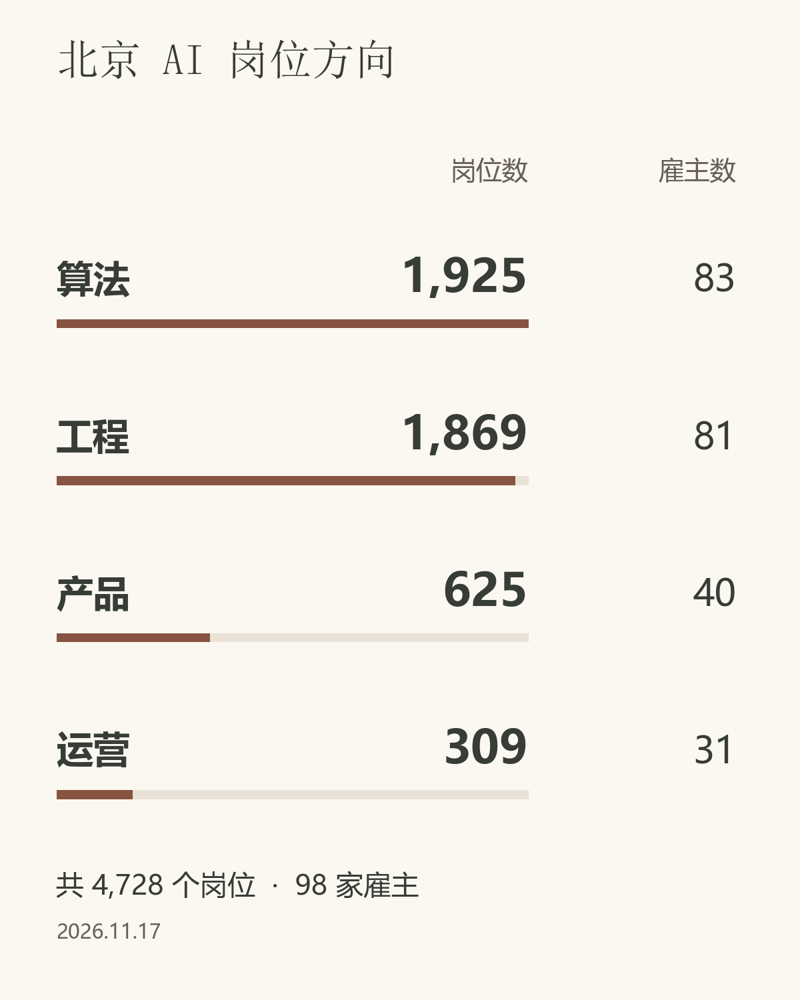

# 北京 AI 岗位

核查目录中的 307 个公司与团队，找到 98 家雇主的 4,728 个北京 AI 岗位。更新于 2026 年 11 月 17 日。

| 方向 | 岗位数 | 雇主数 |
| --- | ---: | ---: |
| [算法](#算法) | 1,925 | 83 |
| [工程](#工程) | 1,869 | 81 |
| [产品](#产品) | 625 | 40 |
| [运营](#运营) | 309 | 31 |

[全部岗位明细](beijing-jd-sample.csv) · [307 家核查记录](beijing-employer-audit.csv)

工作地点须明确包含北京。先采用官网职位，再用 Ivyea 和 Offer 岛补充。同一雇主的同名岗位合并，每个岗位按主要职责归入一个方向。雇主可以跨方向出现，招聘人数不计入岗位数。未找到可确认岗位的雇主保留在核查记录中。

## 算法

[查看全部 1,925 个算法岗位](https://ningsiyuan1024.github.io/ai-company-map/docs/beijing-jobs-1.html)

## 工程

[查看全部 1,869 个工程岗位](https://ningsiyuan1024.github.io/ai-company-map/docs/beijing-jobs-2.html)

## 产品

[查看全部 625 个产品岗位](https://ningsiyuan1024.github.io/ai-company-map/docs/beijing-jobs-3.html)

## 运营

[查看全部 309 个运营岗位](https://ningsiyuan1024.github.io/ai-company-map/docs/beijing-jobs-4.html)
