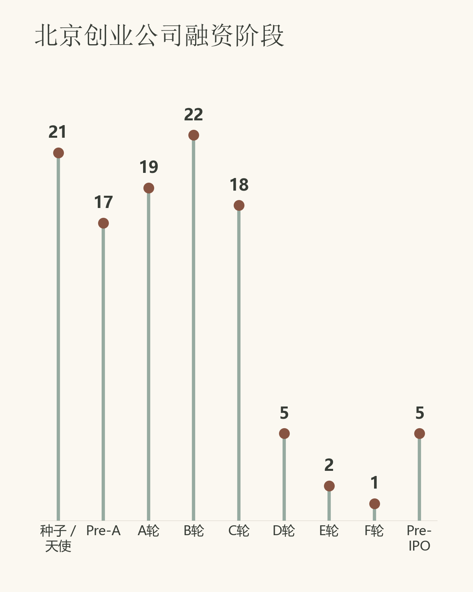
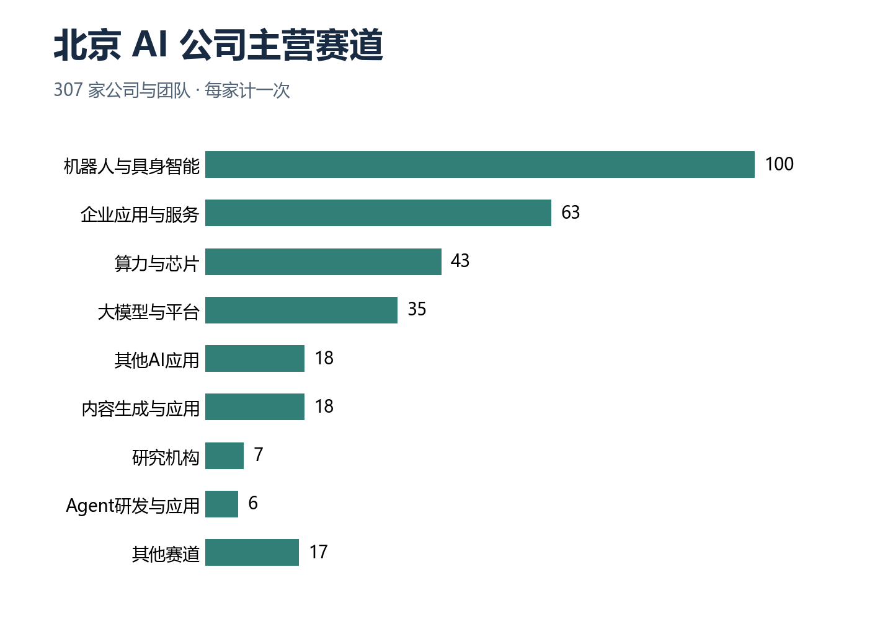
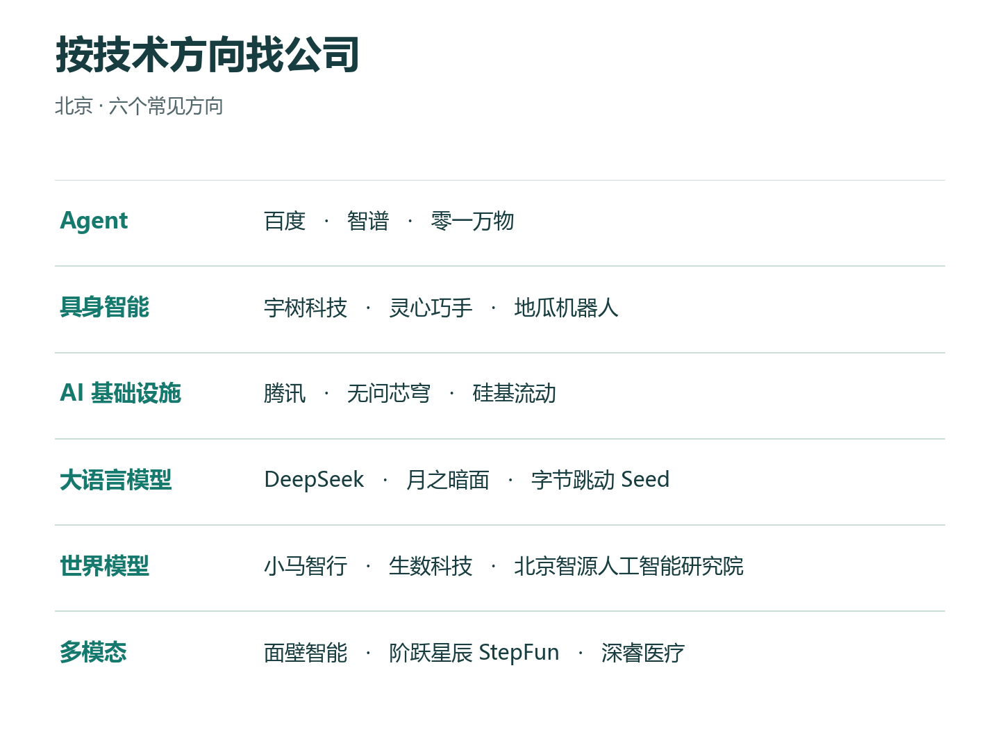
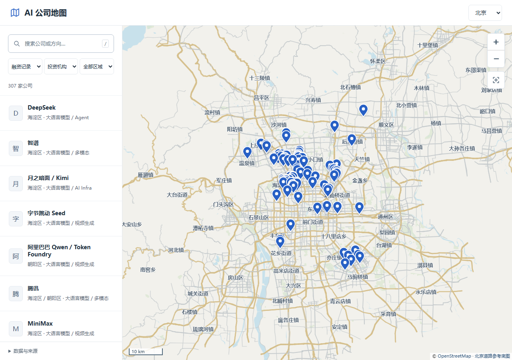
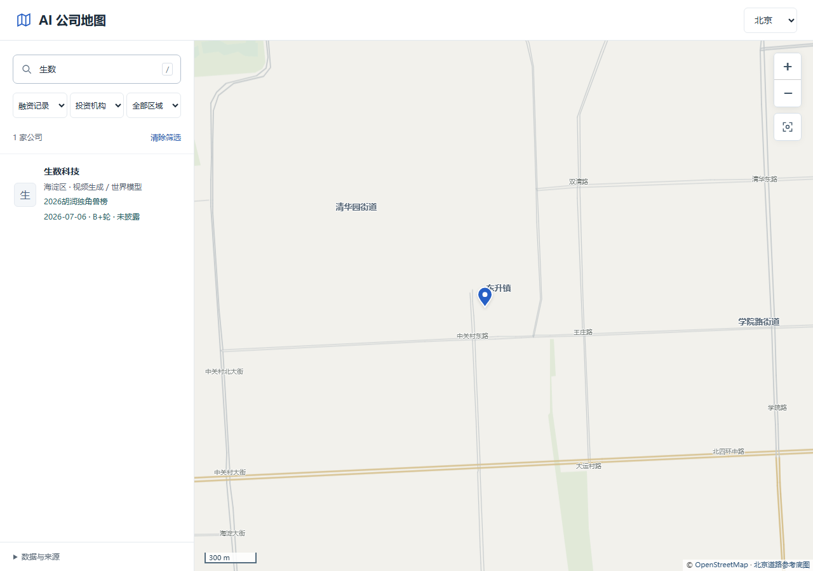
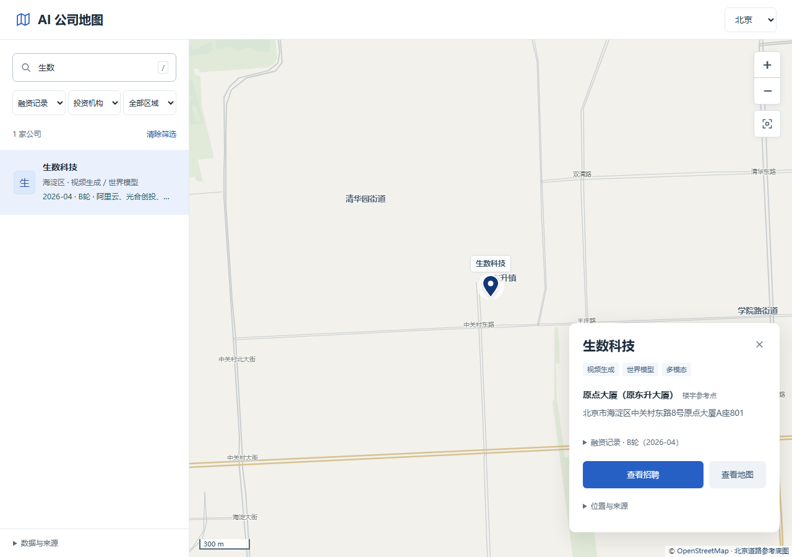
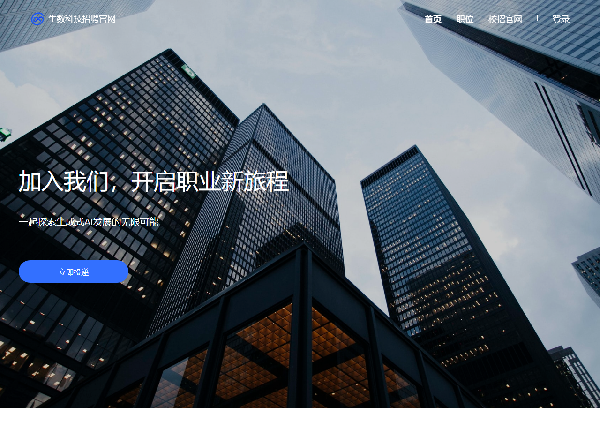

# 北京目录统计与校对依据

统计日期为 2026 年 11 月 14 日，范围为北京目录中的 307 个公司 ID。这里记录统计口径、数据覆盖、名单校对和使用流程，支持核查及补充。

## 公司阶段与数据覆盖

阶段核验已更新为 2026 年来源版本，覆盖 307 行公司记录。72 家有主体或集团上市证据，1 家为新三板挂牌；99 家有具名融资轮次，5 家融资未具名，130 家阶段分组待核准。200 家至少匹配到一种融资、证券状态或独角兽证据。

[2026 融资、上市和独角兽完整口径及来源](FINANCE-2026.md) · [307 行核验明细](company-stages-2026.csv)

## 方向统计

主营方向按现有公司分类合并近义项，每家公司计一次，合计 307 家。这个分布反映当前目录的收录结构。

方向标签允许多选，每家公司同一标签只计一次。Agent 和 AI Agent 合并为 Agent。标签数量受已有标签完整度影响。外企属于组织属性，从方向图中排除。

原始公司分类与合并结果见 [公司明细](company-directions.csv)，全部原标签数量见 [标签明细](tag-counts.csv)。机器可读结果见 [statistics.json](statistics.json)。

## 名单校对与证据范围

### 2025 胡润中国人工智能企业 50 强

本次读取胡润研究院原始榜单，并按表中“总部城市”为北京的 19 家逐项核对，19 家均已收录。目录中的北京团队还可以来自总部在其他城市的公司，因此这个数字只描述榜单北京总部企业的覆盖。

榜单按企业价值排名，原文的上市市值时点为 2026 年 1 月 9 日。它能支撑“覆盖榜单中的北京企业”这一表述。[发布方原文](https://hurun.cn/zh-CN/Info/Detail?num=NVR5TGNUYHDH) · [19 家逐项对应表](hurun-beijing-crosscheck.csv)

### 北京市通用人工智能产业创新伙伴计划首批名单

核对北京市政府公开的 2023-05-24 名单，在现有目录中匹配了 11 家成员对应企业或机构。阿里云与阿里达摩院归入阿里巴巴公司记录，集团、业务部门与法人名称的对应关系如下。模型伙伴观察员另有 5 家匹配。

| 名单主体或对应主体 | 本目录记录 |
| --- | --- |
| 阿里云／阿里达摩院（北京） | 阿里巴巴 Qwen / Token Foundry |
| 北京智源人工智能研究院 | 北京智源人工智能研究院 |
| 北京海天瑞声科技股份有限公司 | 海天瑞声 |
| 数据堂（北京）科技股份有限公司 | 数据堂 |
| 北京百度网讯科技有限公司 | 百度 |
| 北京智谱华章科技有限公司 | 智谱 |
| 第四范式（北京）技术有限公司 | 第四范式 / 范式 |
| 昆仑万维科技股份有限公司 | 昆仑万维 Skywork |
| 北京奇虎科技有限公司 | 360 / 纳米AI |
| 北京金山办公软件股份有限公司 | 金山办公 |
| 北京沃丰时代数据科技有限公司 | 沃丰科技 Udesk |

另外 5 家模型伙伴观察员为百川智能、瑞莱智慧、零一万物、澜舟科技和面壁智能。名单还包括政府单位、投资机构与其他企业，本项目没有将这些单位全部收录。名单成员与集团旗下具体团队的身份应按上表理解。[北京市政府原始名单](https://www.beijing.gov.cn/fuwu/lqfw/gggs/202305/t20230524_3111710.html)

### DINQ 公司目录

以 DINQ 的公开五城数据为基础，逐条比对了原始公司 ID、名称、招聘链接和点位来源。北京基线为 298 家，后续通过政府名单、官方招聘页和招聘平台补充为 307 家。岗位与地址按各自来源时点理解。[DINQ 北京原始数据](https://jobs.dinq.me/city-data/beijing.4e9cc77d538d.json)

### 招聘集合平台

Bonjour! 补充方寸跃迁、探索无尽、Ambi AI 的北京岗位；Offer岛补充 Fibona AI；Ivyea Jobs 确认光轮智能包含北京岗位。这 5 家与原目录按名称、别名及已有城市记录去重。平台岗位提供团队发现和工作城市证据。

- [方寸跃迁北京岗位](https://bonjour.bio/jobs-mapping/jobs/064577c4-e5c0-4cae-bfb5-9e7d31013ef6?src=list)
- [探索无尽北京岗位](https://bonjour.bio/jobs-mapping/jobs/63ad8a7b-851a-43fb-ad7e-69d0f63d5beb?src=list)
- [Ambi AI 北京岗位](https://bonjour.bio/jobs-mapping/jobs/0650c54f-b8a3-45c8-97de-e93aaa1e1769?src=list)
- [Fibona AI 北京／远程岗位](https://offerdao.ai/j/agent_0baulc22to81po)
- [光轮智能北京／上海岗位](https://jobs.ivyea.com/jobs/20228)

### 财富世界 500 强与官方岗位

核对 2025 财富原榜中亚马逊、施耐德的集团身份，并分别打开官方招聘页确认北京工作地与岗位职责。亚马逊为应用科学家，施耐德为要求 AI 冷源控制经验的数据中心系统架构师。这项依据覆盖这两家补充雇主。[财富原榜](https://www.fortune.com/ranking/global500/2025/)

### 地图依据

楼宇及园区参考坐标来自原数据记录中的公开地图来源。北京道路、绿地、水域与地名来自 Geofabrik 的 OpenStreetMap 2026-11-12 数据，采用 WGS84，与公司点位匹配。[底图许可与处理说明](../MAP-DATA-LICENSE.md)

## 操作流程截图

截图采自公开部署页面与真实招聘目标页，尺寸为 1280 × 900，日期为 2026-11-14。各步骤使用页面的可分享地址展示对应状态。

### 1 打开北京地图

默认显示北京目录及地理参考点。只有已核验坐标的公司才落点。

### 2 搜索公司

在搜索框输入“生数”，列表显示匹配结果，地图同步显示对应点位。

### 3 查看详情

选择公司，查看地址、技术标签、融资披露与来源，点击“查看招聘”。

### 4 进入企业招聘页

示例目标为生数科技的飞书招聘官网，可继续浏览职位。此截图展示招聘入口，不代表已提交申请。

## 可复核的发布信息

北京目录收录 307 家公司。已逐项核对《2025 胡润中国人工智能企业 50 强》中总部位于北京的 19 家企业，均已收录；同时参考北京市通用人工智能产业创新伙伴计划首批名单、DINQ 目录、企业官方招聘和 AI 招聘平台补充团队。每类证据的覆盖范围见上文。
